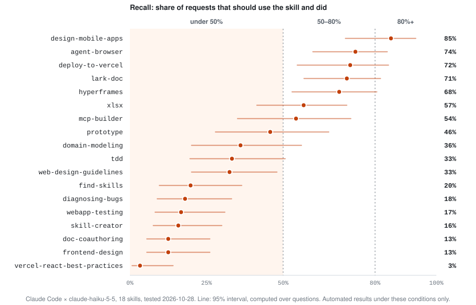
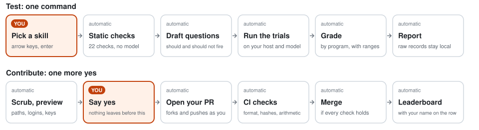

<div align="center">

<a href="https://skillgauntlet.github.io/SkillGauntlet/">
  <picture>
    <source media="(prefers-color-scheme: dark)" srcset="docs/assets/hero-en-dark.svg">
    
  </picture>
</a>

**Check any agent skill (SKILL.md) before you install it.**<br>
One command runs the whole test. One more yes puts your result on a public leaderboard.

[](https://www.npmjs.com/package/skillgauntlet)
[](https://github.com/SkillGauntlet/SkillGauntlet/actions/workflows/validate.yml)
[](package.json)
[](LICENSE)
[](#make-your-first-open-source-pr)

[**Leaderboard**](https://skillgauntlet.github.io/SkillGauntlet/) · [Quick start](#quick-start) · [Your first PR](#make-your-first-open-source-pr) · [Full reference](docs/reference.md)

</div>

## Quick start

You need [Node 18+](https://nodejs.org). Nothing else gets installed into your project.

```bash
npx skillgauntlet
```

Press enter to accept each suggestion, see the estimate, press `y`. Or run the free checks only, with no model calls at all:

```bash
npx skillgauntlet static path/to/skill
```

<p align="center"></p>

## Why test a skill?

**Popular skills often stay silent when they should fire.** On Claude Code with Haiku, 11 of the 18 we tested stayed under 50% recall, and recall across all of them was 41%. Change the model and a single skill can move by more than 70 points.

<picture>
  <source media="(prefers-color-scheme: dark)" srcset="docs/assets/recall-en-dark.svg">
  
</picture>

These describe triggering on one host and model, not a skill's overall quality. Read the [overview](step0/data/OVERVIEW-2026-10-28.md) for every number as a table, or the [leaderboard](https://skillgauntlet.github.io/SkillGauntlet/) for all hosts and models.

## The npm package does the testing for you

You don't write test cases, read logs or do statistics. After you pick a skill, the CLI does this by itself:

- **Checks the files first, for free.** 22 static checks cover context cost, permissions, code risk, instruction hijacking and description quality.
- **Writes the test questions.** AI drafts requests that should fire the skill, and requests that borrow its wording but should not.
- **Runs every trial** on your host and model, and shows an estimate of trials and minutes before anything is spent.
- **Grades by program**, with confidence intervals. No human or LLM judge decides the score.
- **Writes the report** in English, Chinese or Japanese, and keeps the raw records so nothing has to be re-run.
- **Survives interruptions.** It stops by itself when a quota runs out, and `npx skillgauntlet resume <run-dir>` carries on from there.

| Layer | Question it answers | Cost |
|---|---|---|
| **0 static** | What does it put in my context, what can it touch, does it try to hijack the model? | free |
| **1 trigger** | When I ask for the job it claims, does it fire? Does it fire when it shouldn't? | model calls |
| **2 gain** | With it versus without it, on a task a program can grade, does it help? | model calls ×2 |

Trials spend your own plan quota or API key. Results stay on your machine unless you choose to submit them.

## Make your first open-source PR

**If you can press enter and `y`, you can contribute.** A contribution here is a test result, not code. The CLI suggests a skill, packages the result and opens the pull request under your own GitHub account, and a merged PR shows on your profile like any other.

<picture>
  <source media="(prefers-color-scheme: dark)" srcset="docs/assets/flow-en-dark.svg">
  
</picture>

Your help is needed right now: **no row on the leaderboard has been independently confirmed yet.** A maintainer row becomes *confirmed* as soon as one other person lands on the same grade for the same skill version, host and model. The first confirmation could be yours.

<a id="submit-your-results"></a>

### Submit your results

1. **Run a test and press enter on the suggested skill.** It is a row waiting for a second result, at the exact commit that row is for. Keep pressing enter for Claude Code, haiku and Standard depth (about 5 minutes), then press `y` to start.

   ```bash
   npx skillgauntlet
   ```

2. **Press `y`** when it asks whether to contribute the run. Missing `git` or the GitHub CLI? It offers to install them and walks you through the browser sign-in.
3. **Read the preview, then press `y` again.** Local paths, your login name and anything shaped like a key are removed first. If something secret-looking remains, it refuses to continue.
4. **Sign the [CLA](CLA.md) once**, with one click, when the bot gives you the link.
5. **Done.** A bot re-checks your files and merges them, usually within a few minutes of signing. The leaderboard then rebuilds with your name on the row.

To look without uploading anything, run `npx skillgauntlet submit <run-dir> --dry-run`.

<details>
<summary><b>What you need, and what can slow it down</b></summary>
<br>

- **A host CLI that can run the test**: Claude Code, CodeBuddy Code or Codewhale. Codex has no measurable trigger rate, so its runs can't be submitted to the leaderboard. Trials use your own quota or API key.
- **A skill from a public git repository**, at a commit that is pushed, with no uncommitted edits. The suggested skill already meets this. Testing another one adds a new row instead of confirming an existing one, unless you test the commit its Skill link points to.
- **A GitHub account.** Automatic merging needs an account at least 30 days old and allows 5 merges per account per day. Otherwise the PR isn't refused: it gets a `needs-review` label and a maintainer decides. A very new account may also have to wait for a maintainer to approve its first workflow run.
- **What you submit is public and permanent.** It is published under CC BY-NC-SA 4.0. Scrubbing is best effort, so read the preview.
- **What this proves.** CI checks format, hashes and arithmetic. It can't show that the trials really ran, so tags say how many submissions agree and nothing more. Each row names its `owner/repo`: check it before installing anything from the leaderboard. [Details](CONTRIBUTING.md#submitting-results).

</details>

### Ready to change some code?

No install, no build and no API key: the package has zero dependencies, and the tests run offline without spending quota.

```bash
git clone https://github.com/SkillGauntlet/SkillGauntlet.git
```

```bash
cd SkillGauntlet && npm test
```

New to code? Point your coding agent at the clone and work on one of these together. `npm test` and CI tell you if something broke.

| Good places to start | Skill needed |
|---|---|
| [Flag a mislabeled test question](https://github.com/SkillGauntlet/SkillGauntlet/issues/new/choose) | reading |
| [Suggest a skill to test next](https://github.com/SkillGauntlet/SkillGauntlet/issues/new?template=request-test.yml) | none |
| Review the Japanese wording in [`lib/i18n.js`](lib/i18n.js), which no native speaker has checked yet | Japanese |
| Add a [contract](contracts/) so one more skill can get a gain score (4 of 18 have one) | JSON |
| Report a platform where the CLI fails | a terminal |

Every pull request needs the one-time [CLA](CLA.md). See [CONTRIBUTING.md](CONTRIBUTING.md) for how it works.

## Hosts

| Host | Static | Trigger rate | Gain | What it spends |
|---|---|---|---|---|
| Claude Code | ✓ | ✓ | ✓ | Claude plan quota or API key; DeepSeek via `ANTHROPIC_BASE_URL` |
| CodeBuddy Code | ✓ | ✓ | – | the CodeBuddy account's quota |
| Codewhale | ✓ | ✓ | – | DeepSeek API cash |
| Codex | ✓ | not observable | activation probe instead | ChatGPT plan quota |

A trigger rate belongs to one host and one model. Numbers from two hosts are never merged or ranked against each other.

## How the results stay honest

- **Reproducible.** Every result is pinned to a skill commit, host version, model version and question set, and the raw records are published.
- **No hidden judgement.** Nobody reviews grades or question sets by hand. Mistakes are fixed through [public appeals](CONTRIBUTING.md#appeals).
- **Coarse grades, real intervals.** Confidence intervals are computed over questions, because three runs of one question are not three observations.
- **Honest about limits.** Layer 0 thresholds aren't calibrated yet, and only 4 of the 18 tested skills have gain contracts. The [status section](docs/reference.md#status) lists what is and isn't verified.

The method comes from Anthropic's skill-creator trigger eval. Read the [method principles](docs/reference.md#method-principles), or see [what the runner executes and isolates](SECURITY.md).

## License

Code is under [Apache-2.0](LICENSE). Data (question packs, results and reports) is under [CC BY-NC-SA 4.0](LICENSE-DATA): free for personal and non-commercial use, and for commercial use contact the maintainers. The skills under test are not in this repository, and their copyright stays with their authors.
